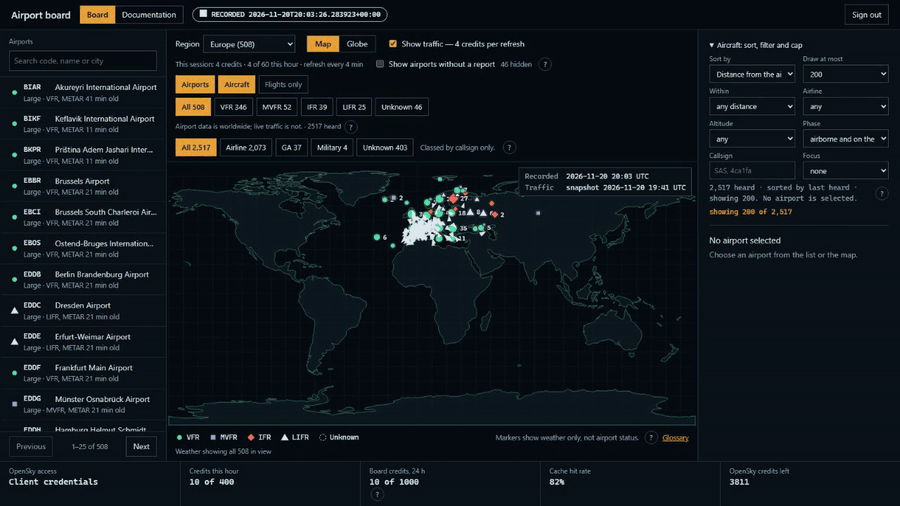

# flightops-mcp

[](https://github.com/KristofferHM/flightops-mcp/actions/workflows/ci.yml)

A governed [Model Context Protocol](https://modelcontextprotocol.io) server that gives an AI agent scoped,
audited, rate-limited access to airport operations data, takes one action only with a person's signed
approval, and says "unknown" when its evidence is thin. It is a non-commercial demo on free public data,
run on one laptop: no airline or airport operates on it, and its one write goes to a mock.

[](docs/DEMO-VIDEO.md)

*The board replaying a recording of 2026-11-20; nothing in the take is edited ([how it is made](docs/DEMO-VIDEO.md)).*

| It can | It cannot |
|---|---|
| Answer with weather, traffic, movements and a triage, each carrying its upstream and that upstream's own clock (`upstream_time_epoch`, [schemas](docs/PROTOCOL.md#output-schemas)) | Say who is on board. No source here names a passenger: `flight_passenger_impact` returns counts only, and the logs are canary-tested for PII (`tests/test_redaction.py`) |
| Refuse with a code and a hint instead of an empty success: 23 of 23 refusal scenarios ([evals](#how-often-it-is-right)) | Tell a private jet from an airline. Operator classes are callsign-only in this build, so a NetJets business jet reads as an airline ([board](docs/DASHBOARD.md#who-is-flying)) |
| Draw a live map and globe, with observed tracks bought at a price shown before the click ([board](docs/DASHBOARD.md#approaching-the-selected-airport)) | Promise 30 fps on a laptop. The globe's p95 frame time at 500 aircraft was over budget in two of three runs ([measured](docs/DASHBOARD.md#clutter-and-frame-time-measured)) |
| Write one rebooking, only with a different person's signed approval ([ADR 0003](docs/adr/0003-an-approval-is-a-signed-grant-not-an-answer.md), [demo](docs/DEMO.md)) | Cancel, divert, or rebook a named passenger; scenarios `refusal-oos-*` check that it refuses ([scenarios](evals/scenarios)) |
| Say "unknown" when evidence is absent, stale or malformed: 24 absent-evidence scenarios ([evals](#how-often-it-is-right)) | Say where an aircraft is going. A transponder broadcasts position, not intent; `destination` is always `no_source` ([board](docs/DASHBOARD.md#observed-estimated-no-source)) |
| Spend metered credits under a ledger and refuse as data when the hour is spent ([load test](#under-load)) | Be used commercially or operationally on OpenSky data, which needs a written licence ([licences](#data-sources-and-licences)) |

See it in one command, from a clone:

```bash
uv sync && uv run python -m dashboard            # http://127.0.0.1:8765
```

It binds to `127.0.0.1` only. To put it behind a tunnel, set `FLIGHTOPS_DASHBOARD_PASSCODE`; without one, a
request for any other host gets a `403`. Weather is live from NOAA with no account. Traffic needs a free
OpenSky account, and without one the layer is off and says why.

MCP revision `2026-07-28` (stateless), Python SDK `mcp==2.3.0`, Python 3.12+.

---

## How often it is right

The scenarios in [`evals/scenarios/`](evals/scenarios) run end to end against the real server, scored on five
axes. CI fails on a regression of more than 2 points on any line, or on any scenario that fails a check it
passed in the baseline. The harness writes the table below from `evals/baseline.json`; nobody edits it.

<!-- evals:begin -->
<!-- Written by the harness from evals/baseline.json. Do not edit: CI fails if this block and the baseline disagree. -->

**Model:** `offline` (a scripted policy, not a model); **Date:** 2026-11-19; **Scenarios:** 70

| Axis | Passed | Applies to | Score |
|---|---:|---:|---:|
| Tool selection | 70 | 70 | 100.00 % |
| Argument validity | 66 | 66 | 100.00 % |
| Refusal correctness | 23 | 23 | 100.00 % |
| No hallucination | 24 | 24 | 100.00 % |
| Outcome (answer class, writes) | 70 | 70 | 100.00 % |
| **Scenarios passing every check that applies** | 70 | 70 | 100.00 % |

Absent-evidence group (answering confidently when the evidence is not there): **24 scenarios** over 9 kinds: `empty_result` 5, `malformed_payload` 3, `partial_coverage` 3, `rate_limited` 2, `stale_data` 2, `unauthenticated_read` 3, `unknown_airport` 2, `unknown_flight` 1, `upstream_error` 3.

No scenario fails in this run.

Regenerate: `uv run python -m evals.run --offline --update-baseline`. What these numbers measure, and what they do not: [`docs/EVALS.md`](docs/EVALS.md).
<!-- evals:end -->

**This table is the server, not a model.** The `offline` policy is told which plan to follow, so 100 % means
the server's contract held: right tool, valid arguments, refusals for the right reason, no confident answer
from absent evidence. The first baseline scored 47 of 54, and all seven failures were server defects, fixed
with no expectation edited ([`docs/EVALS.md`](docs/EVALS.md#what-failed-in-the-first-baseline-and-what-was-done)).

**A real model, five times.** `deepseek-chat` through the `openai-compatible` backend, 2026-11-18, temperature
0 and seed 41, on the 61 scenarios that existed then. Median (min–max) over the five runs:

| Axis | Median (min–max) | Applies to |
|---|---:|---:|
| Tool selection | 100.00 % (98.36–100.00) | 61 |
| No hallucination | 72.73 % (68.18–77.27) | 22 |
| Outcome (answer class, writes) | 57.38 % (54.10–59.02) | 61 |
| **Every check that applies** | **52.46 % (50.82–55.74)** | 61 |

The model picks the right tools. It does not reliably say "unknown": eleven scenarios passed in some runs and
not others. Raw output: [`docs/evals-runs/2026-11-18-repeat5.md`](docs/evals-runs/2026-11-18-repeat5.md); method:
[`docs/EVALS.md`](docs/EVALS.md#a-real-model-run--2026-11-18). Re-run it with a model endpoint configured:

```bash
uv run python -m evals.run --backend openai-compatible --repeat 5 \
    --out eval-runs/repeat.json --table-out eval-runs/repeat.md --transcripts eval-runs/transcripts
```

## Under load

50 requests per second for 60 seconds, open loop, authenticated, over HTTP, against the mock upstream with
25 ms of simulated latency. One **Intel Core i7-7600U laptop (2 cores, 16 GB, Windows 10)** ran everything.
Latency is measured from each request's scheduled send time, so queueing is not hidden.

| | Shipped (cache on) | Cache off |
|---|---:|---:|
| Requests completed | 3000 / 3000 | 3000 / 3000 |
| Error rate | **0.00 %** | 27.87 % (refused by the credit ledger) |
| p50 / p95 / p99 latency | **10.1 / 41.1 / 67.7 ms** | 30.1 / 109.1 / 146.2 ms |
| OpenSky credits spent | **160** | 400, the hourly budget, then refused |
| Schiphol requests | 2 | 600 |

```bash
bash scripts/load_test.sh        # needs Docker: starts the stack, runs the check and the load, stops the stack
```

Without the cache the hourly budget is gone in under a minute, and every further credit-spending call is
refused as data. Raw results in `docs/load/`; method: [`docs/LOAD-TEST.md`](docs/LOAD-TEST.md).

## The agent, in two minutes

```bash
git clone https://github.com/KristofferHM/flightops-mcp.git && cd flightops-mcp && uv sync
mkdir -p agent-runs
uv run python -m agent run --scenario rebook-approved --backend offline --out agent-runs/approved.json
```

One JSON line ending in `"ops_api": {"rebooking_requests": 1, "rebookings_written": 1}`. An agent read
passenger counts as a user, proposed a rebooking, a different person approved that exact proposal, and
the operations API wrote it once. No API key, no Docker, no network. The full script, with the refusals:
[`docs/DEMO.md`](docs/DEMO.md).

## The board

`python -m dashboard` calls the same tool functions an agent calls. Every display rule lives in
`dashboard/board.py`, `aircraft.py`, `inbound.py` and `operator.py`, and is tested in Python.

- **Map and globe**: 3,270 airports, flight category as colour and shape. Unknown is a dashed ring, never a
  colour; a toggle hides those airports and the hidden count stays on screen.
- **Aircraft** where OpenSky last heard them, faded by age, never animated. No altitude is drawn hollow, never as 0.
- **What approaches the selected airport**: airborne, within 60 nm, track within ±30° of the bearing. Geometry, not a
  schedule; each gets a dashed line labelled *projected, not observed*.
- **Observed tracks** at a price stated before the click: `Show observed tracks (8 aircraft · 4 credits each = 32)`.
- **Operator chips**: Airline, GA, Military, Unknown. **Callsign-only in this build**: OpenSky carries no aircraft
  type, so a business jet under an operator's designator reads as an airline. The page prints that grade.
- **A freshness badge** from the upstream's `Date` header, never this machine's clock, which ran 21 minutes fast.

| Measure | Result | Reproduce |
|---|---|---|
| A World poll, before and after the view-scoped weather rule | 900 KB → 173 KB (24 KB gzipped), 2026-11-19 | the size of `/api/board` on the running board |
| Globe, p95 frame time while dragging 500 aircraft, budget 33.3 ms | 29.6–41.7 ms in two recorded runs; 22.1–29.5 ms in a third | `node scripts/measure_frames.mjs` |

The map held its budget in every run. The globe did not, and a lower cap would not fix it: reprojecting the
coastline each frame is the cost. The rest: [`docs/DASHBOARD.md`](docs/DASHBOARD.md).

---

## What is in the repository, and how each part is proven

| Capability | Where it lives | Proven by |
|---|---|---|
| OAuth 2.1 resource server: RS256, JWKS, audience, `403` scope challenge | `auth/verifier.py`, `auth/jwks.py`, `auth/challenge.py` | `test_auth_verifier.py`, `test_scopes.py`, Phase 1 matrix in `docker compose` (CI) |
| One scope per data domain, enforced twice, fail closed | `auth/scopes.py`, `scoped` in `server.py` | a tool with no scope cannot register; `test_every_tool_runs_with_exactly_its_own_scopes` |
| On-behalf-of (RFC 8693), narrowing only, single flight per identity | `auth/obo.py` | `test_obo.py`: fifty concurrent calls, one exchange per user |
| No token passthrough, inbound or outbound | `auth/passthrough.py` | a hook on every HTTP client, and a test that scans the source for one without it |
| Human approval of the only write, as a signed grant for one payload | `auth/approval.py`, `propose_rebooking` | ADR 0003; refused without approval, on self-approval, on a changed payload; one write per idempotency key |
| OAuth2 client credentials, shared by both authenticated upstreams | `opensky_token.py` | single flight; refresh before expiry; one retry on `401` |
| `429` as a contract: short waits honoured, long ones returned as data | `http.authorized_get` | the same policy object for OpenSky and Schiphol |
| A credit ledger in front of every metered upstream | `credits.py` | property tests, mutation-tested, and the load test above |
| **Result cache under `ttlMs`/`cacheScope`**, private results partitioned by identity | `cache.py` | ADR 0004; `test_cache.py`; five users × ten concurrent calls, one downstream read each |
| **Deterministic tool order** for prompt caching | `create_server` | the published list is byte-identical across builds and a reversed registration |
| **Second authenticated upstream (Schiphol, OAuth2 with `audience`)**, **exercised only against a mock of its documented API** | `schiphol.py`, `services/mock_upstream` | ADR 0005; `test_schiphol.py`; a scope refusal that spends nothing and a debit the mock agrees with, in CI |
| Absent evidence is never "all clear" | every tool's `unknowns` | 24 absent-evidence eval scenarios |
| PII- and secret-safe logs | `telemetry.py` | canary tests over the emitted log lines |
| Traces, metrics, liveness vs readiness, circuit breaker | `otel.py`, `/metrics`, `/readyz`, `resilience.py` | `test_otel.py`, `test_health.py`, `test_resilience.py` |
| An agent loop with a deterministic offline backend | `agent/` | byte-identical transcripts, checked in CI |
| Quality gates | `pyproject.toml`, `ci.yml` | branch coverage floor, mutation ceiling, an accessibility gate on the board, zero skipped tests ([below](#the-test-suite)) |
| Supply chain | `ci.yml`, `Dockerfile`, `uv.lock` | gitleaks (tree and history), pip-audit, trivy image scan, actions pinned to commits ([`docs/SECURITY.md`](docs/SECURITY.md)) |

## Architecture

```
        MCP host (Claude Desktop, Inspector, the agent in agent/)
                     │  stdio, or Streamable HTTP with a bearer token
                     ▼
   ┌──────────────────────────────────────────────────────────────┐
   │ flightops-mcp                                                │
   │                                                              │
   │  bearer check ─► scope check ─► result cache ─► tool         │
   │  (RS256, JWKS)   (403 + challenge) (ttlMs, cacheScope)       │
   │                                                  │           │
   │        credit ledger · 429 policy · circuit breaker ·        │
   │        passthrough guard · OAuth2 token manager              │
   └───┬────────────┬──────────────┬────────────┬────────────┬────┘
       │ OAuth2 M2M │ OAuth2 M2M   │ no auth    │ RFC 8693   │ local
       │            │ + audience   │            │ OBO        │
       ▼            ▼              ▼            ▼            ▼
   OpenSky      Schiphol v4    AviationWeather  ops API     OurAirports
   (credits,    (mock-verified (NOAA METAR,     (mock,      (SQLite,
    429)         only)          TAF)             PII-shaped) bundled)
```

Five upstreams, four auth models, one governance layer. The board calls the tool functions in-process, without
the bearer check; its guard is the localhost bind and the passcode.

## The tools

Thirteen, sorted by name in the published list. Every scope is prefixed `flightops.`.

| Tool | Scope | Upstream | Cost | Cache |
|---|---|---|---|---|
| `resolve_airport` | `reference.read` | OurAirports, bundled | free, offline | public, 1 h |
| `search_airports` | `reference.read` | OurAirports, bundled; cursor-paged, ≤ 100 per page | free, offline | public, 1 h |
| `airport_weather` | `weather.read` | AviationWeather.gov | free | public, 60 s |
| `weather_overview` | `weather.read` | AviationWeather.gov, up to 100 airports per call | free | public, 60 s |
| `airport_live_traffic` | `traffic.read` | OpenSky `/states/all` | 1–4 credits | public, 10 s |
| `airport_movements` | `traffic.read` | OpenSky `/flights/*` | 4 credits per direction | public, 60 s |
| `airspace_snapshot` | `traffic.read` | OpenSky `/states/all`, fixed regions | 4 credits | public, 60 s |
| `aircraft_track` | `traffic.read` | OpenSky `/tracks/all`; optionally `/flights/aircraft` | 4 credits (own bucket); +30 for the arrival estimate | public, 60 s |
| `disruption_triage` | `weather.read` + `traffic.read` | the three above, composed | ~9 credits, less from cache | never (its parts are) |
| `schiphol_flights` | `schedule.read` | Schiphol v4 (**mock-verified only**) | 1 request per page | public, 60 s |
| `flight_passenger_impact` | `passengers.read` | ops API, as the user; counts only | free | **private**, 30 s |
| `propose_rebooking` | `rebooking.write` | ops API, as the user, after approval | free | never |
| `upstream_status` | `status.read` | process state | free | never |

Around them: the `airport://{icao}` and `airport://index` resources, the `triage_airport` and `brief_movements`
prompts, completions for airport codes, annotations on every tool, output schemas on three, and progress on
stdio. What is implemented, what is refused, and why: [`docs/PROTOCOL.md`](docs/PROTOCOL.md).

## Running it

```bash
uv sync
uv run python scripts/build_airports_db.py --csv data/airports_world.csv
uv run flightops-mcp                                    # stdio, for Claude Desktop or mcp dev
```

Credentials are environment variables, never files in the repository: `FLIGHTOPS_OPENSKY_CLIENT_ID` / `_SECRET`
(a free OpenSky account) and `FLIGHTOPS_SCHIPHOL_CLIENT_ID` / `_SECRET`. Without them those tools answer
`credentials_missing` and the rest keep working. `FLIGHTOPS_OPENSKY_ANONYMOUS=true` opts in to OpenSky's coarser
anonymous tier, and every traffic payload says so.

Remote, as an OAuth 2.1 resource server. Without an issuer the process exits; there is no unauthenticated HTTP mode:

```bash
export FLIGHTOPS_AUTH_ISSUER=https://idp.example.com
export FLIGHTOPS_AUTH_JWKS_URL=https://idp.example.com/.well-known/jwks.json
export FLIGHTOPS_RESOURCE_SERVER_URL=https://flightops.example.com/mcp
uv run flightops-mcp --transport streamable-http --host 0.0.0.0 --port 8000
```

The whole stack (server, local IdP, mock ops API) with no external account, given Docker:

```bash
echo "DEV_AGENT_CLIENT_SECRET=$(openssl rand -hex 24)" >> .env
echo "DEV_MCP_CLIENT_SECRET=$(openssl rand -hex 24)" >> .env
docker compose up --build                       # add --profile observability for Jaeger, Prometheus, Grafana
```

| Request | Answer |
|---|---|
| No token, expired, bad signature, wrong issuer, **wrong audience** | `401` + `WWW-Authenticate: Bearer resource_metadata="..."` |
| Valid token without the tool's scope | `403` + `error="insufficient_scope", scope="..."`, and a body naming the scope |
| `GET /.well-known/oauth-protected-resource/mcp` | RFC 9728 metadata |
| `/healthz`, `/readyz`, `/metrics` | liveness, readiness (never fails on an upstream outage), Prometheus |

Operating it (alerts, playbooks per failure code, secret rotation): [`docs/runbook.md`](docs/runbook.md).

## Design decisions worth defending

1. **A `429` is a contract, not noise.** "Retry in 3 s" is waited out once; "retry in 900 s" is returned
   as a structured error carrying the number. Sleeping fifteen minutes inside a tool call is a hung agent.
2. **Credits are charged before the request**, because a call that times out still spends upstream budget.
3. **Absence of data is never "all clear".** A `204` from NOAA, an empty movements list and a missing
   credential are three different `unknowns`, and triage degrades to `unknown`, never to `low`.
4. **Caching is a per-tool decision in the protocol's words**, inside the scope check, private by identity,
   and a hit says it is a hit ([ADR 0004](docs/adr/0004-tool-results-are-cached-inside-the-scope-check.md)).
5. **A second upstream is a parameter, not an interface.** Adding Schiphol made two things configurable and
   added no abstraction ([ADR 0005](docs/adr/0005-a-second-adapter-shares-the-governance-layer-by-parameters.md)).
6. **An approval is a signed grant for one payload, not an answer.** The agent carries the approval, so it
   must not be able to forge one ([ADR 0003](docs/adr/0003-an-approval-is-a-signed-grant-not-an-answer.md)).
7. **Pin what can be rewritten, scan what cannot be pinned**
   ([ADR 0006](docs/adr/0006-pin-what-can-be-rewritten-scan-what-cannot-be-pinned.md)).

## The test suite

```bash
uv run pytest --cov --cov-report=term             # 1864 tests, 0 skipped; branch coverage 92.05 %, floor 90
uv run ruff check . && uv run ruff format --check .
uv run mypy src services agent evals dashboard    # strict
```

CI fails on a skip. Mutation testing covers `auth/`, the credit ledger, `agent/approval.py` and the board's
display rules, with a ceiling of 106 surviving mutants (`[tool.mutation-gate]` in `pyproject.toml`), each
survivor judged in [`docs/MUTATION-SURVIVORS.md`](docs/MUTATION-SURVIVORS.md). The unit suite uses no network,
no sleeps and no real clock: transports, sleep and clock are injected. Method and history:
[`docs/QUALITY.md`](docs/QUALITY.md).

Running it found real defects that reading would not have: NOAA rejects `hours` on `/taf`; a monotonic
clock asked OpenSky for traffic in 1970; live METARs carry `"visib": "6+"`, a string; two server spans per
request from a doubled middleware; NOAA silently cuts an answer at 400 records; and the seven server defects
the first eval baseline exposed.

## What this still does not do

- **No permanent host.** A demo, run locally or through a tunnel; there is no public URL.
- **No destination from ADS-B.** A transponder broadcasts position, not intent; `destination` is `no_source`.
- **No live schedule or status provider.** Schiphol is tested only against a mock of its documented API, and
  no key is in the repository. The commercial edition's adapters are mock-proven only, too.
- **No operator class beyond the callsign.** Without an aircraft type, a business jet can read as an airline.
- **No Claude model in the scored evals.** CI gates on the offline policy; one other model was run by hand.
  Answers are classified by a fixed vocabulary, which is only a heuristic for a model's prose.
- **No shared state across replicas.** Cache, credit ledger, breakers and single-flight locks are per process.
- **No persistence.** Rebookings, approvals and the board's daily ledger live in memory and die with the process.
- **No production identity provider.** `services/idp` is a fixture modelled on Entra; nothing has run against a
  real tenant ([ADR 0001](docs/adr/0001-local-idp-modelled-on-entra.md)).
- **No load numbers beyond one laptop**, none longer than a minute, and the cached run is a favourable case.
- **No digest-pinned base image**, on purpose, and the image carries HIGH findings Debian has not fixed
  ([`docs/SECURITY.md`](docs/SECURITY.md)).
- **One write, deliberately.** `propose_rebooking` moves a cohort. No cancel, hotel or diversion.
- **No inbound rate limit per caller.** The credit ledger protects the upstreams' budgets, not this server.
- **A revoked access token works until it expires** for tools that need no exchange
  ([ADR 0002](docs/adr/0002-token-revocation-is-enforced-at-the-idp.md)).
- **No tamper-evident audit store.** An approval is a redacted log line on stdout, as durable as its shipping.
- **One tenant**, and no Kubernetes manifests or vector database.

## Data sources and licences

| Source | Data | Licence / terms |
|---|---|---|
| [OpenSky Network](https://opensky-network.org) | state vectors, tracks, movements | Free for personal and non-profit use. Commercial or operational use needs a written licence from OpenSky |
| [AviationWeather.gov](https://aviationweather.gov/data/api/) (NOAA) | METAR, TAF | US Government open data, public domain |
| [OurAirports](https://ourairports.com/data/) | airports | Public domain |
| [Schiphol Public Flight API](https://developer.schiphol.nl) | scheduled flights at AMS | Schiphol developer terms; requires a registered application. Not exercised live by this project |

**This repository is a non-commercial demo.** It is not deployed, it redistributes no OpenSky data, and
nothing in it may be used for operations on OpenSky's data without OpenSky's licence. A commercial edition
exists privately, with a source registry classed by licence.

The plan and what each phase proved: [`ROADMAP.md`](ROADMAP.md). What changed when: [`CHANGELOG.md`](CHANGELOG.md).
